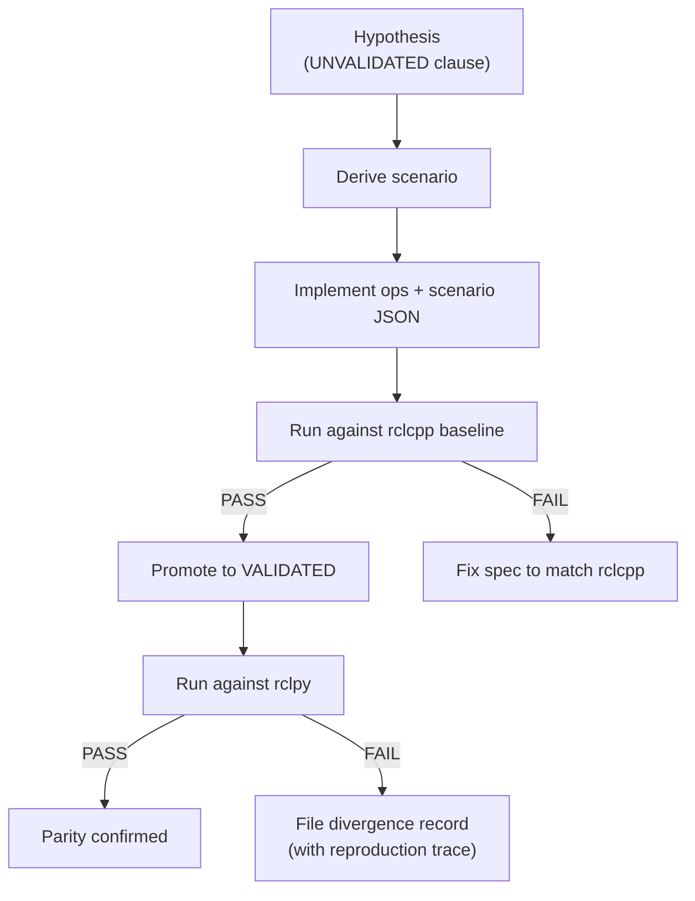

# Spec-Scenario Realignment Plan (Detailed)

> **Principle:** Spec → Scenario → Test → Evidence. If a known divergence isn't caught, a spec clause is missing.
> **Authority:** Observable results from rclcpp+Jazzy baseline and the open codebase. Nothing else.

## Root Cause

The specs cover the **value layer** (what does get return? does set succeed?) but are **silent on the descriptor metadata layer** (what does `describe_parameters` report after mutations?). The known rclcpp/rclpy divergences live exactly in that silent zone.

Because there's no spec clause saying "descriptor.type MUST reflect the current value type after a successful set," there's no scenario testing it, and there's no test catching the known rclpy divergence where it doesn't update the descriptor.

The fix is not to hunt for GitHub issues. It's to complete the specs so divergences are caught structurally.

---

## Phase 0: Evidence Integrity (DO FIRST)

Before adding new specs or scenarios, verify the harness can be trusted.

### Evaluator Audit

The `must_observe` matcher in `eval.rs` does consume matches (`next_idx += rel + 1`) and enforce ordering (`events[next_idx..]`). But `matches_pattern` is a recursive subset matcher — loose patterns risk false passes.

1. **Audit**: Check every P-series pattern for missing value assertions
2. **Negative test**: Construct a pattern set that SHOULD miss, verify evaluator reports FAIL
3. **Fix if needed**: Only add evaluator features if the audit reveals actual false-pass risk

### Concurrent Reader Op

Implement `concurrent_read_during_batch`:
1. Reader thread polls `get_param` in a tight loop on target params
2. Main thread fires `set_params_non_atomic` batch
3. Op reports all intermediate states observed → `partial_state_observed: true/false`

Both backends use native threading (C++ `std::thread`, Python `threading`). Minimal — one new op.

**Files to modify:**
- `backend_prod/src/ops/params.cpp`: New `exec_concurrent_read_during_batch()`
- `backend_prod/src/backend.cpp`: Register in dispatch
- `backend_py/ops/params.py`: New handler with `threading.Thread`
- `backend_py/backend.py`: Register in `OP_HANDLERS`

---

## Phase 1: Complete the Specs

Add missing clauses to [parameter_core.md](file:///home/ecm/ai-workspace/projects/ros2-semantic-contracts/docs/spec/core/parameter_core.md). All new clauses are ⚠️ UNVALIDATED hypotheses — each must be verified against rclcpp before promotion.

### Coverage Map: 9 Known Divergences → Spec Gaps

| # | Issue | Series | Missing Spec Clause | Priority |
|---|---|---|---|---|
| 1 | rclcpp#2512: GetParameterTypes response length for undeclared | P | **SPEC_PC12** (new) | **Now** |
| 2 | rclpy#1490: Clock jump recovery / timer stall | C | No clock spec exists | Future |
| 3 | rclpy#1460: Static type no-default throws | P | **SPEC_PC11** (new) | **Now** |
| 4 | Discourse: EventsExecutor arrival order vs wait-set priority | E | No executor spec exists | Future |
| 5 | rclpy#1452: MT executor reentrancy | E | No executor spec exists | Future |
| 6 | rclpy#1448: Empty service/topic name handling | G | No graph robustness spec | Future |
| 7 | rclpy#1056: spin_once(timeout=0) semantics | E | No executor spec exists | Future |
| 8 | rclpy#1491: Use-after-destroy behavior | S | No shutdown spec exists | Future |
| 9 | rclcpp#525: Negative duration arithmetic | C | No clock spec exists | Future |

Items 1 and 3 are immediately actionable. Items 2, 4-9 validate the approach for future spec families.

### New Clauses (all UNVALIDATED)

#### SPEC_PC09 — Descriptor Reflects Current State

> ⚠️ **UNVALIDATED (baseline hypothesis)**

After a successful set operation on a dynamically typed parameter, `describe_parameters` MUST report a descriptor whose `type` field matches the current value's type.

- This is the **observable contract** for descriptor correctness.
- rclcpp on Jazzy: updates descriptor.type on set (**to be verified**).
- Source: Derived from rclcpp behavior (top-level docs silent).

**Why this matters:** rclpy#879 shows rclpy deduces type from value on declare but doesn't update on set. This clause makes that divergence testable.

---

#### SPEC_PC10 — Explicit Descriptor Type Enforcement

> ⚠️ **UNVALIDATED (baseline hypothesis)**

When a parameter is declared with an explicit `ParameterDescriptor.type` field, the declared type MUST be enforced. If the initial value's type conflicts with the declared descriptor type, declaration MUST fail or the descriptor type MUST take precedence.

- Source: Derived from rclcpp behavior (top-level docs silent).
- rclpy#879 shows rclpy **ignores** `ParameterDescriptor.type` and deduces from value.

---

#### SPEC_PC11 — Declaration Without Default Value

> ⚠️ **UNVALIDATED (baseline hypothesis)**

A parameter MAY be declared without a default value if a value is expected to be supplied at launch time.
- If no value is available at declaration time, the parameter MUST be in state `NOT_SET` until set.
- Declaration without a default MUST NOT unconditionally raise an exception.

- Source: Derived from rclcpp behavior.
- rclpy#1460 shows rclpy **always** raises exception on static-typed param without default.

---

#### SPEC_PC12 — GetParameterTypes Response Contract

> ⚠️ **UNVALIDATED (baseline hypothesis)**

`get_parameter_types` MUST return a response array with a 1:1 mapping to the request array.
- For undeclared parameters (in declared-only mode), the corresponding entry MUST be `PARAMETER_NOT_SET` (type 0).
- The response array length MUST equal the request array length.

- Source: `rcl_interfaces/srv/GetParameterTypes` IDL contract.
- rclcpp#2512: rclcpp returns empty array, rclpy returns different length — both may violate the IDL's 1:1 mapping.

---

### Spec Fixes

#### SPEC_P08 — Fix deletion event claim

```diff
 ### SPEC_P08 — Optional Deletion Support [P14]

 Parameter deletion support is optional.
 - If supported, deletion MUST be documented.
-- Deleted parameters MUST be reported via parameter events.
++ ⚠️ **UNVALIDATED (baseline hypothesis)**
++ Deleted parameters SHOULD be reported via parameter events.
++ Baseline observation (Jazzy+rclcpp): `undeclare_parameter` does NOT emit
++ a `ParameterEvent` to `/parameter_events`. Top-level docs are silent on
++ deletion event requirements. Until upstream clarifies, the baseline
++ behavior (no event) is treated as truth.
```

#### SPEC_PC08 — Fix change-record-on-delete claim

```diff
 ### SPEC_PC08 — Deletion Support [P14]

-⚠️ **UNVALIDATED (baseline hypothesis)**
+⚠️ **UNVALIDATED (baseline contradicts)**

 Deletion support is optional but must be deterministic if present.
-- If supported, deletion of a parameter MUST generate a change record indicating removal.
++ If supported, deletion of a parameter SHOULD generate a change record
++ indicating removal. Baseline observation: Jazzy+rclcpp does NOT generate
++ a change record on undeclare.
 - Deletion of an `Unknown` parameter MUST fail or be a no-op...
```

---

## Phase 2: Derive Scenarios and Implement

Each new spec clause produces one scenario. Scenario design and implementation happen together — a scenario isn't done until it can run.

| Spec Clause | Scenario | What It Measures |
|---|---|---|
| SPEC_PC09 | **P21** | `describe_param` after `set_param` — does descriptor.type track? |
| SPEC_PC10 | **P22** | Declare with explicit `ParameterDescriptor.type` — enforced? |
| SPEC_PC11 | **P23** | Declare static-typed param without default — exception? |
| SPEC_PC12 | **P24** | `get_parameter_types` response length — matches request? |
| SPEC_PC05 | **P25** | `concurrent_read_during_batch` — partial state visible? |

### P21 Scenario Shape (from SPEC_PC09)

```json
{
  "ops": [
    {"op": "declare_param", "payload": {"name": "meta_probe", "value": "hello", "descriptor": {"dynamic_typing": true}}},
    {"op": "describe_param", "payload": {"name": "meta_probe"}},
    {"op": "set_param", "payload": {"name": "meta_probe", "type": "integer", "value": 42}},
    {"op": "describe_param", "payload": {"name": "meta_probe"}}
  ],
  "expects": [{
    "check": "custom",
    "params": {
      "must_observe": [
        {"type": "op_end", "detail": {"op": "describe_param", "name": "meta_probe", "descriptor": {"type": 4}}},
        {"type": "op_end", "detail": {"op": "set_param", "name": "meta_probe", "successful": true}},
        {"type": "op_end", "detail": {"op": "describe_param", "name": "meta_probe", "descriptor": {"type": 2}}}
      ]
    }
  }]
}
```

The last `describe_param` expects `type: 2` (INTEGER). P21 must be verified against rclcpp first. If rclcpp doesn't update the descriptor type either, then SPEC_PC09 is wrong and needs correction. The spec is a hypothesis until the baseline proves it.

### Implementation Work Per Scenario

**P21 — No new ops needed.** Uses existing `declare_param` (with `dynamic_typing: true`), `set_param`, `describe_param`. New entry in `scenarios_P.json`.

**P22 — Enhance `declare_param` to accept `descriptor.type`.**
- `backend_prod/src/ops/params.cpp`: Parse `descriptor.type` from payload, pass to `rcl_interfaces::msg::ParameterDescriptor`
- `backend_py/ops/params.py`: Same — pass `descriptor.type` to `ParameterDescriptor`
- New entry in `scenarios_P.json`

**P23 — Enhance `declare_param` for no-default mode.**
- `backend_prod/src/ops/params.cpp`: Allow omitting `value`, call `declare_parameter(name, descriptor)` without value
- `backend_py/ops/params.py`: Same path through rclpy API
- New entry in `scenarios_P.json`

**P24 — New op: `get_parameter_types`.**
- `backend_prod/src/ops/params.cpp`: New `exec_get_parameter_types()` — calls `node->get_parameter_types(names)`, returns type array
- `backend_prod/src/backend.cpp`: Register in dispatch
- `backend_py/ops/params.py`: New handler — calls `node.get_parameter_types(names)`
- `backend_py/backend.py`: Register in `OP_HANDLERS`
- New entry in `scenarios_P.json`

**P25 — New op: `concurrent_read_during_batch`.**
- `backend_prod/src/ops/params.cpp`: Spawn reader thread polling `get_parameter`, fire `set_parameters` (non-atomic) on main, collect intermediate states
- `backend_prod/src/backend.cpp`: Register in dispatch
- `backend_py/ops/params.py`: Same with `threading.Thread`
- `backend_py/backend.py`: Register in `OP_HANDLERS`
- New entry in `scenarios_P.json`

### Build Verification

After implementation, before measurement:
- `colcon build` succeeds for both backends
- Each new scenario runs without crash or trace schema violation

---

## Phase 3: Measure

For each new scenario:

1. **Run against rclcpp baseline first**
   - PASS → promote spec clause from UNVALIDATED to VALIDATED
   - FAIL → spec hypothesis was wrong, correct to match observed rclcpp behavior

2. **Run against rclpy**
   - PASS → parity confirmed, document it
   - FAIL → file divergence record with exact commands to reproduce and raw trace diff

3. **Regression**: confirm P01-P20 still pass for both backends

```bash
# Verify against rclcpp baseline
ORACLE_BACKEND=prod ./harness/scripts/run_harness.sh scenarios_P 2>&1 | grep -E "P2[1-5]"

# Run against rclpy
ORACLE_BACKEND=py ./harness/scripts/run_harness.sh scenarios_P 2>&1 | grep -E "P2[1-5]"

# Regression
ORACLE_BACKEND=prod ./harness/scripts/run_harness.sh scenarios_P
ORACLE_BACKEND=py ./harness/scripts/run_harness.sh scenarios_P
```

---

## Phase 4: Documentation

- Update [scenario_execution_matrix.md](file:///home/ecm/ai-workspace/projects/ros2-semantic-contracts/docs/provenance/scenario/scenario_execution_matrix.md) with observed results
- Update [missing_semantics.md](file:///home/ecm/ai-workspace/projects/ros2-semantic-contracts/docs/provenance/missing_semantics.md) — remove items validated, add cross-references
- File divergence records in [divergence_records/](file:///home/ecm/ai-workspace/projects/ros2-semantic-contracts/docs/provenance/divergence_records/) for confirmed failures

Every divergence record includes: scenario ID, spec reference, exact reproduction commands, raw trace excerpts, classification per `divergence_records/README.md`.

---

## Methodology



---

## Future: C/E/G/S Series

The 7 remaining known divergences belong to spec families without scenarios yet. Same pattern:

1. Create spec file (e.g., `clock_core.md`, `executor_core.md`)
2. Add UNVALIDATED clauses derived from rclcpp baseline behavior
3. Derive scenarios, implement backend ops, verify against rclcpp, run against rclpy

P-series realignment proves the methodology before scaling.
